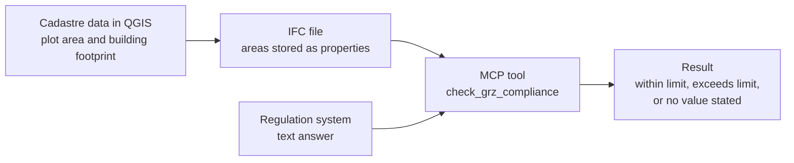

# IFC compliance check as an MCP tool

A small prototype: an MCP server with one tool that compares how much of a plot is actually built on with the site coverage limit that an AI system states for that plot.

**Status: prototype from August 2026.** It works end to end as plumbing. Its most useful result is that it exposed a defect in the system it was checking. Read the limits before the numbers.

## The idea

My M.Sc. thesis system answers building-regulation questions for Stuttgart in text ([results and failure analysis](https://github.com/meet-rehman/digital-building-permit-stuttgart)). A text answer alone does not tell you whether it is right. I wanted a check against something the language model cannot influence: measured areas from the cadastre.

The site coverage ratio (GRZ, Grundflächenzahl) is a good test case. It is one number per zone, and the as-built value can be measured: building footprint divided by plot area.

## How it works



1. **Measure.** In QGIS I joined cadastral parcels and building footprints for two Stuttgart plots and took the plot area and the built area.
2. **Store.** A script writes these numbers into a minimal IFC file with IfcOpenShell, as properties on the site and the building.
3. **Ask.** The MCP tool reads the IFC file, computes the as-built ratio, and asks the regulation system for the limit on that plot.
4. **Compare.** It returns one of three outcomes: within the limit, exceeds the limit, or no value stated.

Because the check is an MCP tool, any MCP client, for example Claude Desktop, can call it during a conversation without custom integration code.

| File | What it does |
|---|---|
| [`server.py`](server.py) | The MCP server (FastMCP) with the tool `check_grz_compliance` |
| [`ifc_tools.py`](ifc_tools.py) | Writes and reads the IFC files with IfcOpenShell |
| [`regulation_client.py`](regulation_client.py) | Calls the regulation system's API and pulls the stated GRZ out of its text answer |
| [`generate_test_ifc.py`](generate_test_ifc.py) | Creates the 12 sample files |
| [`dashboard_generate.py`](dashboard_generate.py) | Runs the check on all files and writes an HTML overview |
| [`sample_data/`](sample_data) | The 12 IFC files |

## What happened when I ran it

I ran all 12 files against the deployed system on 14 August 2026.

| Outcome | Files |
|---|---|
| No value stated by the system | 6 |
| System stated a value | 6 |
| Stated value equal to the value I had verified on the plan | 0 |

In all 12 cases the system returned the same generic "consultation report" in place of an answer about the plot. Where a number appeared, it was 0.5 in five cases and 0.6 in one, whatever the plot. The verified values for those six plots range from 0.25 to 0.9.

So the tool reported "within limit" or "exceeds limit" six times, and each of those verdicts rested on a value the system had not found but filled in. **The check ran correctly on wrong input.** That is the finding: the tool made a defect of the text layer visible from outside, on plots where I knew the right answer. The defect and its cause are described in the thesis repository under "Where it fails". The client contains a detector for this report pattern, so such answers are now flagged.

The two plots with measured areas:

| Plot | Plot area | Built area | As-built ratio | Limit on the plan |
|---|---|---|---|---|
| Plot 18A, Bürgerhospital | 10,151 m² | 3,105 m² | 0.31 | 0.8 |
| Plot 20, Archivstraße / Urbanstraße | 12,581 m² | 7,392 m² | 0.59 | 0.9 |

Both are well inside their limit. This comparison, measured value against verified limit, is the one the tool is meant to deliver once the regulation side returns reliable values.

## Limits

- **The IFC files hold numbers, not geometry.** Each file has a site and a building with three properties. Nothing is computed from 3D shapes. IFC is used here as a carrier format.
- **Ten of the twelve files are synthetic.** They assume a plot of 1,000 m² and a footprint equal to the limit times 1,000. Their as-built ratio equals the limit by construction, so they test the plumbing and nothing else. Only the two files ending in `_real` carry measured areas.
- **The limit is read from free text with a pattern match.** It takes the first number that follows "GRZ". This is fragile, and it is how invented values got through.
- **Site coverage only.** No floor area ratio, heights or setbacks. The legal definition of GRZ also counts some paved areas and outbuildings, which this ratio ignores.
- **It depends on a private API** that is currently switched off. Without it the server starts, but the tool cannot return a result.
- **One tool, no tests.**

## Next steps

- Read the limit from a verified table or from the plan itself, not from generated text.
- Compute the footprint and plot area from real geometry in the IFC file.
- Return the source and date of every value with the result.
- Add floor area ratio and building height.

## Running it

```
pip install -r requirements.txt
cp .env.example .env        # set the base URL of a regulation API
python generate_test_ifc.py # writes the sample IFC files
python server.py            # MCP server on http://127.0.0.1:8000/mcp
```

The regulation system itself is not part of this repository.

## Credits

The server follows the tool-registration pattern of [ifcMCP](https://github.com/smartaec/ifcMCP) (Apache-2.0), which I used as a reference. Built with [IfcOpenShell](https://ifcopenshell.org) and [FastMCP](https://github.com/jlowin/fastmcp). Plot and footprint areas are derived from ALKIS open data: Datenquelle: LGL, www.lgl-bw.de, Data licence Germany, attribution, version 2.0.

Author: Abdul Rehman, [github.com/meet-rehman](https://github.com/meet-rehman)
